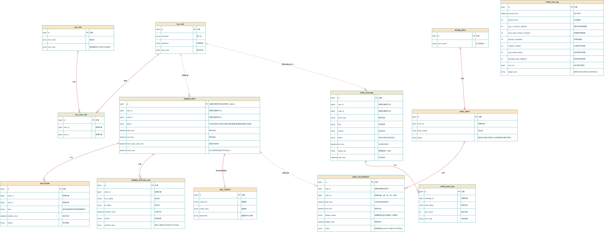

# 概要设计

## 1. 引言

### 1.1 设计依据与运行环境

**软硬件运行环境：**

- **操作系统**：Windows（节点A宿主机）、Ubuntu（节点B轻量虚拟机）
- **运行环境**：Node.js (前端)、JDK 8+ (后端)、MySQL 5.7+/8.0 (数据库)
- **网络环境**：双节点局域网互通，通过局域网 IP 进行通信与远程调用。

### 1.2 设计约束与UML同步机制

- **UML模型边界**：本设计说明书中的 UML 部署图为软件的**逻辑架构图纸**；具体的机器配置、端口开放等实操部署以成员6输出的《部署说明文档》为准，二者用途不同，严禁混用。
- **UML同步要求**：UML 图源文件与渲染图片需要跟随业务逻辑变更同步更新。若开发过程中业务逻辑发生改变影响 UML 模型，开发人员须主动通知成员3更新 PlantUML 源文件与图片，提交成员2更新本设计文档，以保障模型与系统实现的一致性。

## 2. 概要设计（高层）

### 2.1 体系架构设计

本系统采用 **C/S（Client/Server）+ 分层架构 + 双节点分布式** 的体系架构。系统各层职责明确、高内聚低耦合。

1. **表现层（Web 前端）**：负责用户交互与页面渲染，通过 Axios 封装发起 RESTful 请求，统一携带 JWT 鉴权 Token。
2. **业务逻辑层（后端 4 个子系统）**：独立的 SpringBoot 工程，对外暴露 REST 接口。各子系统之间通过局域网 IP 发起 HTTP 远程调用，遵循《REST接口契约》。
3. **数据访问层（MySQL）**：采用双节点物理隔离部署。各子系统仅允许访问本节点的数据库，**严格禁止跨节点直连数据库**。

### 2.2 子系统职责划分说明

系统拆分为 4 个独立的高内聚子系统：

| 子系统名称          | 部署节点/端口    | 核心职责说明                                                                            |
|:-------------- |:---------- |:--------------------------------------------------------------------------------- |
| **统一身份权限子系统**  | 节点A / 8081 | 负责用户注册、登录；签发与校验 JWT 令牌；实现全局权限拦截（区分学生/管理员）；全局异常处理。                                 |
| **自习室座位资源子系统** | 节点A / 8082 | 负责自习室与座位的 CRUD；维护本地“时段占用记录表”；提供携带时段参数的锁座接口，实现并发防重与释放逻辑。                           |
| **预约订单流转子系统**  | 节点B / 8083 | 负责订单全生命周期状态机流转；负责违约记录的生成；**维护全局业务配置参数（`BIZ_CONFIG` 表）**；调用座位接口进行锁座/释放；调用通知接口推送消息。 |
| **监控与消息通知子系统** | 节点B / 8084 | 负责定时任务调度（扫描超时/暂离超时/到期）；负责消息的异步推送。**注：不直连其他数据库，仅作调度与通知，业务阈值统一读取订单子系统配置，不自行判断。**    |

### 2.3 双节点部署架构设计

项目实际落地采用**双节点物理隔离部署**，节点之间依靠局域网 IP 完成 REST 接口远程调用。

* **节点 A（Windows 宿主机）**
  * **部署模块**：Web 前端、身份权限子系统 (8081)、座位资源子系统 (8082)。
  * **数据库**：`auth_db`、`room_seat_db`。
* **节点 B（Ubuntu 轻量虚拟机）**
  * **部署模块**：订单流转子系统 (8083)、监控消息通知子系统 (8084)。
  * **数据库**：`order_db`、`notify_db`。

**容错边界说明**：节点A身份权限与座位查询不依赖节点B，节点B订单/通知故障时，节点A登录鉴权、自习室/座位查询仍可对外服务。订单子系统主流程依赖座位锁座与通知推送：通知子系统（8084）故障时订单业务可执行，但预约超时、暂离超时、使用到期的自动释放与消息推送失效，恢复后由定时任务按周期补偿；节点B整体不可用时订单业务不可用，节点A身份与座位查询正常。该边界与需求5.3故障场景一致，具体测试步骤不在本设计重复。

(注：此处由成员3绘制的 UML 双节点部署图与构件图后补充插入)

### 2.4 全局设计约束（硬性规定）

为了保障分布式环境下的稳定性与可维护性，全体开发必须遵守以下全局约束：

1. **禁止跨子系统直连数据库**：任何子系统只能访问本节点本子系统对应的数据库；跨子系统数据交互统一使用 REST 接口获取，**实体关联均为逻辑外键，严禁建立物理外键，严禁跨库执行 JOIN 查询**。
2. **统一返回与鉴权机制**：全局统一 JSON 返回格式 `{code, message, data}` 与全局错误码表；后端接口统一添加 `@CrossOrigin` 跨域注解；用户请求透传 JWT Token，定时任务/内部调用统一使用内部服务 Token (`X-Internal-Token`)，**内部接口清单由《REST接口契约》统一定义**。
3. **配置化与防硬编码**：所有服务地址、数据库地址、端口、业务参数一律写入配置文件读取。严禁在源码或提交仓库中硬编码 `localhost` 或固定 IP。
4. **定时任务架构约束**：
   * 定时任务由通知子系统（8084）统一调度触发。
   * 具体的订单状态变更、违约记录生成由订单子系统（8083）负责执行。
   * 座位释放由座位子系统（8082）负责执行。
   * **通知子系统只负责发消息，严禁直连其他数据库**。签到时长、暂离时长等业务阈值判断统一以订单子系统的配置（`BIZ_CONFIG` 表）为准。

### 2.5 高层 E-R 图与数据模型设计

系统核心实体按节点物理隔离（分为 `auth_db`、`room_seat_db`、`order_db`、`notify_db`），实体之间仅建立逻辑外键关联。

> **重要架构说明：**
> 
> 1. 下图中跨节点/跨子系统的连线（如订单与座位占用、用户与消息）均为**逻辑外键**。
> 2. 实际数据库脚本中**严禁建立物理外键**。
> 3. 订单子系统包含 `biz_config` 表用于维护全局业务阈值；通知子系统包含 `notify_task_log` 表用于记录调度执行状态，`notify_push_log` 记录消息推送日志。
> 4. **E-R 图字段及表结构补充说明**：
>    - `ORDER_INFO` 含 `id`（逻辑外键，与 SEAT_OCCUPANCY.order_id 同类型同值）及暂离开始时间字段 `temp_leave_start_time`（支撑 FR-SYS-05 暂离超时扫描）。
>    - `VIOLATION` 含 `violation_time`、`reason` 字段，对齐需求6.1违约记录字段。
>    - `SEAT_OCCUPANCY` 完整字段清单：`id`、`seat_id`、`order_id`（唯一约束，一单一座）、`start_time`、`end_time`、`release_status`（逻辑释放标记）、`release_time`、`action`（释放原因）。且 `seat_id+start_time` 建有索引。
>    - `ORDER_INFO` 含 `id`（逻辑外键，与 SEAT_OCCUPANCY.order_id 同类型同值）、`seat_id`、`user_id`、`status`、`start_time`、`end_time`、暂离开始时间字段 `temp_leave_start_time`（支撑 FR-SYS-05 暂离超时扫描）及进入终态时间 `finish_time`（仅终态有值，进行中为NULL）。
>    - `BIZ_CONFIG` 含 `description` 字段，方便维护。

